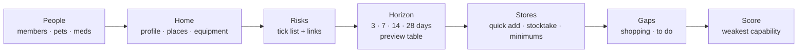
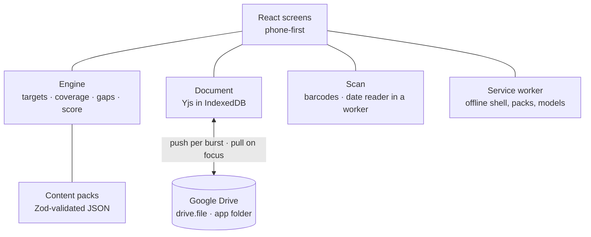

# Design

What SHTF Planner is and how it hangs together, as built in 0.1.0. The words are in
[GLOSSARY.md](../GLOSSARY.md), the rules and their reasons in [decisions/](decisions/README.md),
and each feature's detail in its [feature hub](features/README.md).

## What it is

Tell it about your home, your household and the risks where you live, and pick how long you want to
cope without help. It says what that means for your family, what you already have, what is missing
and what to do about it, and it keeps score.

A phone-first, offline-first PWA for family and friends, Android first. The household is one
document in the browser, synced through the user's own Google Drive. There is no server. UK first,
with a US guidance pack.

## Principles

1. **It's your household.** Targets come from your people (ages, medication, a baby's next nappy
   size), your home (an all-electric house with solar but no EPS has no heat in a power cut) and
   your horizon, computed for a date so you can preview six months ahead.
2. **Capabilities, not shopping.** The question is "can we keep one room warm for two weeks", not
   "do we own a heater". Equipment and stock answer it together.
3. **Honest score.** Over-stock is neutral and "enough" says stop; forgetting the baby or the dog
   zeroes a capability; plans count beside tins.
4. **Low burden.** Entry in seconds (search, barcode, the camera reads the best-before date).
5. **Grounded guidance.** Curated, versioned packs with a source and a date checked on every number.
6. **Private by default.** Nothing leaves the phone but your document, to your own Drive, and a
   scanned barcode's digits, to Open Food Facts.

See [product principles](decisions/product-principles.md).

## The journey



Setup takes a few minutes; the first stocktake takes an afternoon. See
[setup](features/setup/README.md), [inventory](features/inventory/README.md),
[scanning](features/scanning/README.md) and [gaps and score](features/gaps-and-score/README.md).

## The model

Six levels, from what the score is about down to what is on the shelf:

```
Capability   heat, food, water…           what the household can do without the grid
  Resource   bottled gas kg, food kcal…   what targets ask for and stock provides
  Category   Fuel, Food, Water…           the pack's grouping
  Item       "Baked beans"                generic, from the pack only
  Product    "Heinz Beanz 415 g"          the household's own, with size and barcodes
  Stock      3 tins, Pantry, 2027-06      a quantity in a place, with a best-before month
```

You store specifics; the app counts them through their item. A product may count towards nothing.
There are no custom items: a recurring "nothing fits" means the pack needs an item.

Around the stock sit:

- **Places**, each **rotating** (a pantry: it counts at most the household's **minimum** of each
  item, because what is there today runs down by next week) or **stored** (everything counts), with
  **conditions** (frost, heat, damp, indoor-stable) checked against each item's **suitability**.
- **Equipment** (heaters, stoves, generators, batteries, solar, an EV with vehicle-to-load, radios)
  under Home, never as stock, with answers to its type's questionnaire. Equipment converts fuel held
  as stock into hours of heat or cooking, or Wh.
- **People and pets**: members with a date of birth, risk tags and medication; pets by species and
  size.
- **Plan items**: things to do or know (meeting point, shut-offs, documents), done or not.

See [stock model](decisions/stock-model.md) and the [data model hub](features/data-model/README.md).

## The engine

Everything hangs off one loop of pure functions in `src/engine/` (no React, no storage, no Drive):

```
people + home + risks + horizon  ──►  TARGETS    per capability and resource, for a date
stock + minimums + equipment     ──►  COVERAGE   per target
TARGETS − COVERAGE               ──►  GAPS       buy · back to minimums · to do · plans
COVERAGE / TARGETS               ──►  SCORE      per capability, overall, weakest named
```

- **Targets.** Guidance rules give an amount per person, pet or household per day (or a fixed kit),
  by age band, multiplied by matching risk tags, risks and insulation, for the horizon. A pack
  applies when its lowest horizon band is at or below the chosen horizon.
- **Coverage.** Stock counts through its product's item (label kcal where known); rotating places
  count up to their minimum; expired stock counts nothing. Converters share fuel in a fixed order
  (cooking, then heat, then power). Food that needs cooking counts only while cooking is covered;
  raw water only with a way to treat it. Equipment blocked by an answer (solar with no EPS) counts
  nothing and becomes a fix task.
- **Gaps.** Restocks back to minimums first, then a buy row for the rest, as whole packs of an item
  in the household's usual product ("Dried pasta: about 5 kg more"), ranked by price within a 20 %
  band.
- **Score.** Per capability, the product of its targets' cover ratios, each capped at 1; plans are
  (done ÷ total)^1.5; the headline is the mean, with the weakest capability named. The horizon
  preview runs the same engine at 3, 7, 14 and 28 days.

See [engine and scoring](decisions/scoring.md) and the [engine hub](features/engine/README.md).

## Content packs

Versioned JSON in `src/packs/data/`, validated with Zod, bundled so it works offline: **items**
(about 170, at shopping-list level, grouped by category and heading), **assets** (equipment types
with questionnaires, contributions and maintenance schedules), **guidance** (UK 72 hours and grid-free
rules; a US pack), **plans** and **regions** (units, risk-checker links per subregion). Every number
has a source or says `"assumption"`. See [content packs](decisions/content-packs.md) and the
[content packs hub](features/content-packs/README.md).

## Data and sync

The household document is a Yjs CRDT persisted in IndexedDB and shared between tabs. Google Drive,
under the `drive.file` scope with client-side OAuth, holds the CRDT binary and a JSON copy beside it
in an app folder; the app pushes after each burst of edits and pulls on open, on focus and on
demand. The CRDT merges; when the same field changed on two devices, the user picks which copy.
Every environment shares one Drive file, so the file records its schema version and the env that
last wrote it, and the app warns at the moments files come in or go out. Renewing Google's token
always needs a tap. Export and import are JSON or YAML. See [data model](decisions/data-model.md),
[Drive sync](decisions/drive-sync.md), the [data model hub](features/data-model/README.md) and the
[Drive sync hub](features/drive-sync/README.md).

## Privacy

The document holds children's dates of birth, medical conditions and medication. Nothing leaves
the browser except the user's own document to the user's own Drive and the digits of a scanned
barcode to Open Food Facts. Camera frames are read on the phone and never stored or sent. The only
third-party script is Google Identity Services. Location is a rough area only. See
[privacy](decisions/privacy.md).

## Architecture



Vite, TypeScript strict, React, Zod, Vitest and Playwright; `vite-plugin-pwa` with an update prompt
that never reloads under an edit; Cloudflare Pages with dev, next, staging and prod environments.
The lint fence keeps the model, engine and scan code free of React, storage and Drive. See
[AGENTS.md](../AGENTS.md), [platform](decisions/platform.md) and the
[build docs](build/README.md).

## Not built yet

Agreed in the design, not in 0.1.0. Each has an epic; the agreed rules are in
[planned features](decisions/planned-features.md).

| What                                                                                        | Epic                                                      |
| ------------------------------------------------------------------------------------------- | --------------------------------------------------------- |
| Review actions, summary and calendar export                                                 | [#20](https://github.com/pskillen/shtf-planner/issues/20) |
| Equipment linked to its exact fuel, and what is left per piece                              | [#28](https://github.com/pskillen/shtf-planner/issues/28) |
| Scanning round 2: stocktake tuning, a lazily cached date model                              | [#33](https://github.com/pskillen/shtf-planner/issues/33) |
| Scenario checklists, tracked and printable                                                  | [#40](https://github.com/pskillen/shtf-planner/issues/40) |
| Household contacts and a printable ICE sheet                                                | [#45](https://github.com/pskillen/shtf-planner/issues/45) |
| Content and engine breadth: diesel, vehicles, candles, more items                           | [#49](https://github.com/pskillen/shtf-planner/issues/49) |
| Badges and a review streak                                                                  | [#61](https://github.com/pskillen/shtf-planner/issues/61) |
| "Review my plan" by AI through a small proxy with a redacted payload                        | [#65](https://github.com/pskillen/shtf-planner/issues/65) |
| Sharing a household between Google accounts; one sync loop across tabs                      | [#68](https://github.com/pskillen/shtf-planner/issues/68) |
| Platform and quality: iOS check, accessibility, code-splitting, a real name                 | [#72](https://github.com/pskillen/shtf-planner/issues/72) |
| Regional data: per-region flood lookup, Welsh and Northern Irish links, more guidance packs | [#80](https://github.com/pskillen/shtf-planner/issues/80) |
| Several households in one Drive                                                             | [#85](https://github.com/pskillen/shtf-planner/issues/85) |

No push notifications, leaderboard, budgeting, map, vision entry or planning wizard are planned.
